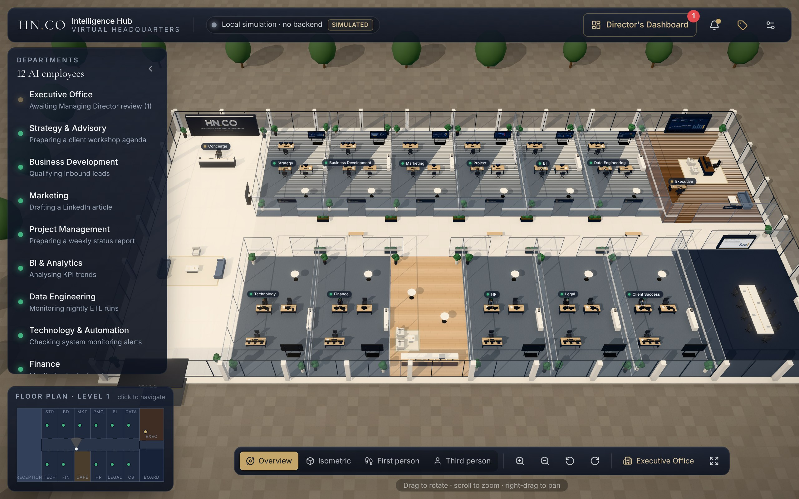
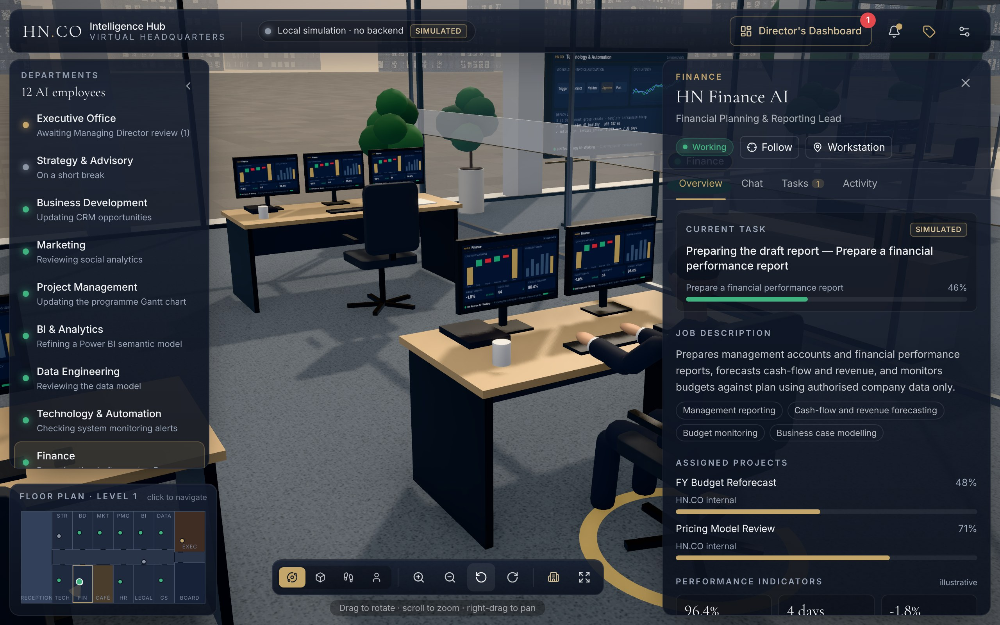
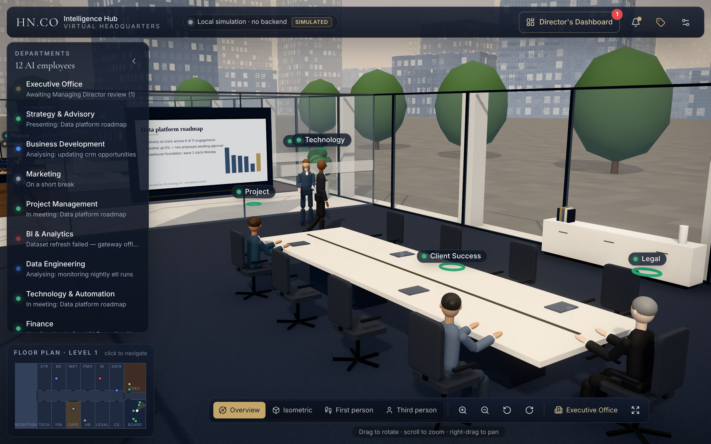
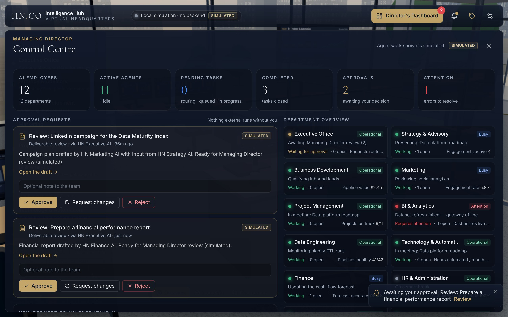
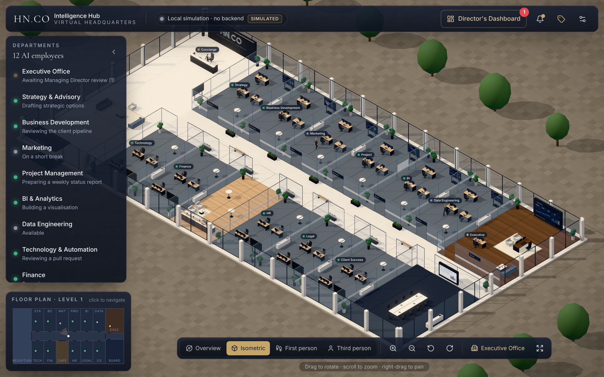

# HN.CO Intelligence Hub — Virtual Headquarters

**Intelligence Behind Every Transformation.**

A 3D virtual headquarters for HN.CO, a boutique business intelligence, data analytics and digital
transformation consultancy. Twelve AI employees work across twelve departments, coordinated by one
central orchestrator and governed by the Managing Director.



| | |
| :--- | :--- |
|  |  |
|  |  |

## What you get

- **A corporate website** (`/`) that leads into the headquarters.
- **A 3D office** (`/hq`) you can explore: reception with the HN.CO logo wall and a concierge, the
  Executive Office with a live performance wall, a glass boardroom, eleven department bays, a café.
- **Twelve AI employees** who sit, type, read their monitors, walk between departments, visit each
  other's desks, attend and present at meetings, and take breaks. A coloured ring shows status:
  green working, blue analysing, gold waiting for approval, grey idle, red needs attention.
- **An employee panel** for each one: role, current task, projects, performance indicators, chat,
  task assignment and activity history.
- **The Managing Director's control centre**: organisation figures, approval requests, new requests,
  an overview of all twelve departments, current work and recent activity.
- **Navigation**: overview, isometric, first-person and third-person cameras, follow an employee,
  zoom, rotate, department list, clickable minimap, clickable office displays, fullscreen.
- **A backend** (FastAPI) with the central orchestrator, the OpenAI Agents SDK workforce, approvals,
  Microsoft Entra ID sign-in with roles, an audit log, PostgreSQL + pgvector and Azure Blob Storage.

## Run it

### 1. The office on its own (no backend)

```bash
cd web
npm install
npm run dev          # http://localhost:3000
```

With no backend the office runs an **in-browser simulation**, and says so on screen.

### 2. With the backend

```bash
cd api
python -m venv .venv && .venv/bin/pip install -e ".[dev]"
cp .env.example .env                      # optional: add OPENAI_API_KEY for live agents
.venv/bin/uvicorn app.main:app --port 8000
```

```bash
cd web
cp .env.example .env.local                # HNCO_API_URL=http://localhost:8000
npm run dev
```

The office finds the backend through its own `/api/hub` proxy and switches from the in-browser
simulation to live events. Add `?mode=simulation` to the URL to force the in-browser simulation.

### 3. Everything in containers

```bash
docker compose up --build    # web :3000, API :8000, PostgreSQL + pgvector
```

## Simulated or real

The office never presents simulated work as real. Every task, message, approval and activity entry
carries a **Simulated** or **Live AI** tag, and the top bar states the current mode.

| Mode | When | What the agents do |
| :--- | :--- | :--- |
| Local simulation | No backend reachable | The browser simulates routing, work, meetings, breaks and occasional errors. Drafts use illustrative figures. |
| Backend, simulated | Backend running without `OPENAI_API_KEY` | The real orchestrator, approvals, audit log and storage run; agent output is templated and labelled. |
| Backend, live | Backend running with `OPENAI_API_KEY` | Agents run on the OpenAI Agents SDK and read only the datasets their department is authorised for. |

The company datasets in `api/app/store/seed.py` are **demo records** marked `demo: true`. Replace
them with approved sources before relying on any figure.

## How a request flows

```
You → 3D Virtual Office → /api/hub proxy → HN.CO Backend → Central AI Orchestrator
    → Departmental AI Agents → (approved integrations) → Database & Knowledge Base
    → live events (Server-Sent Events) → Virtual Office
```

1. You submit a request in the dashboard, to the reception concierge, or to an employee.
2. **HN Executive AI** routes it to a lead department and up to two supporting departments.
3. The lead agent analyses authorised data and drafts the deliverable. In the office it works at its
   desk, visits a collaborator, then walks the draft to the Executive Office.
4. The result waits for the **Managing Director's approval**: approve, request changes or reject.
5. If the request implies an **external action** (send, publish, submit, sign, pay, contact a
   client), that needs a second, explicit approval. No agent tool can perform an external action.

## Security and governance

- **No keys in the browser.** The web app talks only to its same-origin proxy, which forwards an
  allow-list of paths. OpenAI and Azure credentials exist only in the backend.
- **Microsoft Entra ID.** The backend validates access tokens (signature, issuer, audience) and maps
  app roles to permissions. `AUTH_MODE=dev` skips sign-in and is refused when `ENVIRONMENT=production`.
- **Roles.** `Hub.Director` can do everything including approvals; `Hub.Member` can view, assign,
  chat and resolve issues; `Hub.Auditor` can view and read the audit log.
- **Audit log.** Submissions, routing decisions, chat (length only), approvals and external-action
  decisions are recorded with the actor and their roles (`GET /api/audit`).
- **Data access.** Each department can read only its own authorised datasets
  (`api/app/workforce/__init__.py`); the data tools enforce it.

## Going live

| Step | Setting |
| :--- | :--- |
| Live agents | `OPENAI_API_KEY`, optionally `OPENAI_MODEL` |
| Database | `DATABASE_URL=postgresql+asyncpg://…` (tables are created on start; pgvector is used when installed) |
| Artefacts | `AZURE_STORAGE_ACCOUNT_URL` with managed identity, or `AZURE_STORAGE_CONNECTION_STRING` |
| Sign-in (API) | `AUTH_MODE=entra`, `ENTRA_TENANT_ID`, `ENTRA_AUDIENCES` |
| Sign-in (web) | `NEXT_PUBLIC_ENTRA_CLIENT_ID`, `NEXT_PUBLIC_ENTRA_TENANT_ID`, `NEXT_PUBLIC_ENTRA_API_SCOPE` (set at build time) |

Entra ID needs two app registrations: an **API** app that exposes a scope (for example
`api://<api-id>/Hub.Access`) and defines the three app roles, and a **single-page application**
with the redirect URI `https://<your-host>/hq` and permission to call that scope.

See [docs/deployment.md](docs/deployment.md) for Azure Container Apps.

## Project layout

```
shared/catalog.json     The 12 employees and departments (read by both apps)
web/                    Next.js + React + TypeScript + Tailwind, Three.js + React Three Fiber + drei
  src/app/              Landing page, /hq, /api/hub proxy
  src/components/hq/    scene/ (3D office, employees, cameras)  ui/ (panels, dashboard, minimap)
  src/lib/              floor plan, event protocol, store, in-browser simulation, backend client
api/                    FastAPI + OpenAI Agents SDK
  app/orchestrator.py   Central orchestrator: routing, work, approvals, events
  app/workforce/        llm.py (Agents SDK)  simulated.py (no key)
  app/store/            memory.py, postgres.py (+ pgvector), seed.py (demo data)
  app/auth.py           Entra ID tokens and roles
```

## Tests

```bash
cd api && .venv/bin/pytest -q                 # 14 tests: flows, live Agents SDK path, auth, roles
HNCO_TEST_DATABASE_URL=postgresql+asyncpg://… .venv/bin/pytest -q    # + 4 PostgreSQL/pgvector tests
cd web && npm run typecheck && npm run lint && npm run test:sim
```

## Replacing the placeholder characters

The employees are procedural figures (`web/src/components/hq/scene/rig.ts`), built so the office
works with no downloaded assets. To use rigged GLB characters, keep `Agents.tsx` as the owner of
position, route and activity, and swap the instanced body parts for a `useGLTF` model per employee
whose animation clips map to the same activities (sit and type, walk, stand, present, drink).
Run models through `gltf-transform optimize` first; the 3D Web Pack skill `/optimize-3d-assets`
in this repository covers it.

## Known limits

- Live agents were exercised with a scripted test model, not against the real OpenAI API.
- Entra ID was tested with locally signed tokens and up to the Microsoft redirect, not against a
  real tenant.
- Azure Blob Storage and the Azure deployment were not run against Azure.
- No outbound integrations (email, CRM, publishing) are connected. An approved external action is
  recorded as approved and not executed.
- Frame rate was not measured on real graphics hardware. The scene is small (about 65 draw calls)
  and steps quality down automatically, but treat laptop and phone performance as unverified.
- One floor. Characters are placeholders, as above.
